# Agent Room 🤖🏢

A 3D office where an AI team works for you. Walk in, pick an agent (or talk to the whole team),
give a task, and watch them plan, walk to the command table for briefs, type at their desks,
call tools, and report back.

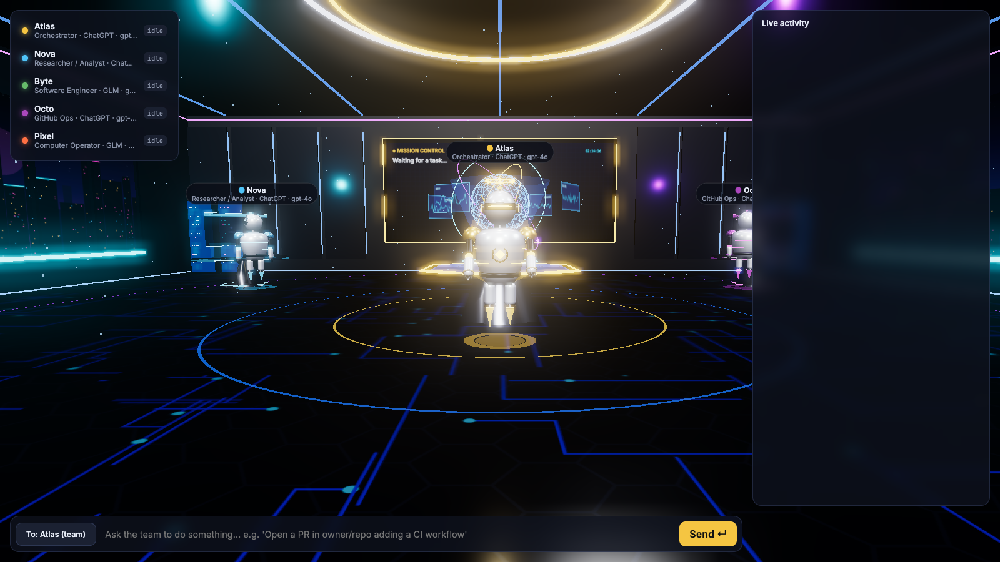

## Tech stack

| Layer | Technology | Used for |
|---|---|---|
| **Language (backend)** | Python 3.12 (3.10+ required) | Server, agents, tools |
| **Web framework** | [FastAPI](https://fastapi.tiangolo.com/) | HTTP API (`/api/info`), static file serving, WebSocket endpoint (`/ws`) |
| **ASGI server** | [Uvicorn](https://www.uvicorn.org/) (`uvicorn[standard]`, `websockets`) | Runs the FastAPI app |
| **Agent orchestration** | [LangGraph](https://langchain-ai.github.io/langgraph/) | `StateGraph` loop: orchestrator ⇄ workers → final report node |
| **Agent framework** | [LangChain](https://python.langchain.com/) (`langchain`, `langchain-core`) | `create_agent` ReAct tool-calling workers, `@tool` definitions, async callback handlers that stream events |
| **LLM client** | `langchain-openai` (`ChatOpenAI`) | Talks to OpenAI and to GLM through its OpenAI-compatible API |
| **Models** | OpenAI **GPT-4o** (default) · Zhipu / Z.ai **GLM-4.6** | Per-agent model choice via `.env` |
| **HTTP client** | [HTTPX](https://www.python-httpx.org/) | GitHub REST API calls |
| **Config** | `python-dotenv` | Loads keys and settings from `.env` |
| **3D rendering** | [Three.js](https://threejs.org/) r160 (ES modules via importmap, jsDelivr CDN) | The room, robots, desks, mission board; `EffectComposer` + `UnrealBloomPass` glow, `CSS2DRenderer` name tags & speech bubbles, `RoomEnvironment` lighting |
| **Markdown** | [marked](https://marked.js.org/) 12 | Rendering the final report |
| **Frontend** | Vanilla JavaScript, HTML, CSS (no build step) | HUD, team panel, live activity feed, approval/report modals |
| **Fonts** | Inter, JetBrains Mono (Google Fonts) | UI typography |
| **Realtime** | WebSockets | Live agent status, messages, tool calls and approval requests |
| **Tooling** | [uv](https://github.com/astral-sh/uv) (optional) | Fast virtualenv + dependency install in `run.sh` |

Versions verified running: FastAPI 0.162 · Uvicorn 0.54 · LangGraph 1.2 · LangChain 1.4 · langchain-openai 1.7 · HTTPX 0.28.

## Screenshots (running locally)

Captured from the app running at `http://localhost:8000`. No API keys were configured for this run,
so the entry screen shows the model chips as ✗ and all agents are idle.

| | |
|---|---|
| 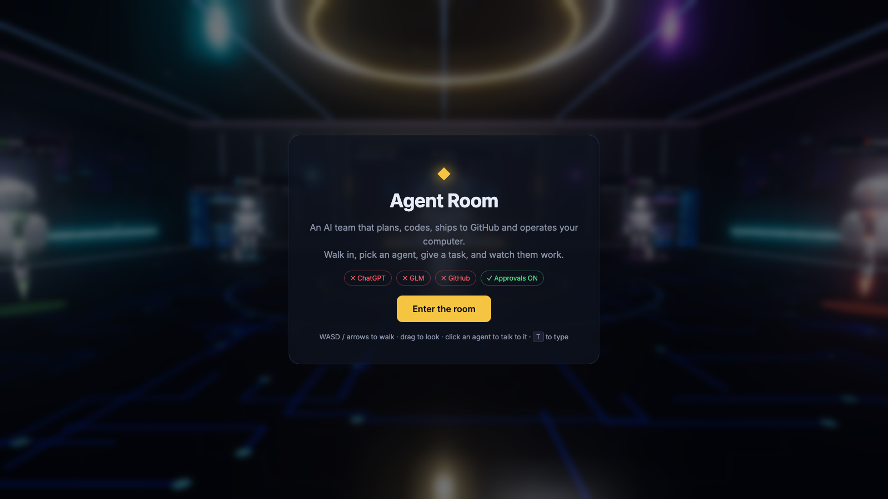 |  |
| **Entry screen** – key/approval status chips | **The room** – Atlas at mission control, team panel, live feed |
| 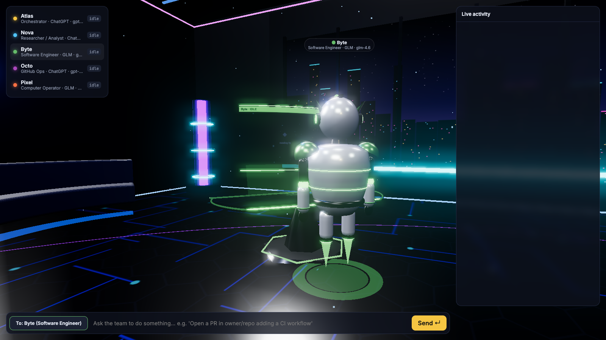 | 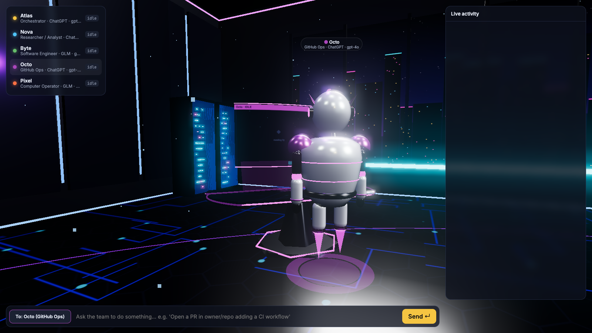 |
| **Byte** (Software Engineer) selected – camera flies to the desk | **Octo** (GitHub Ops) selected |
| 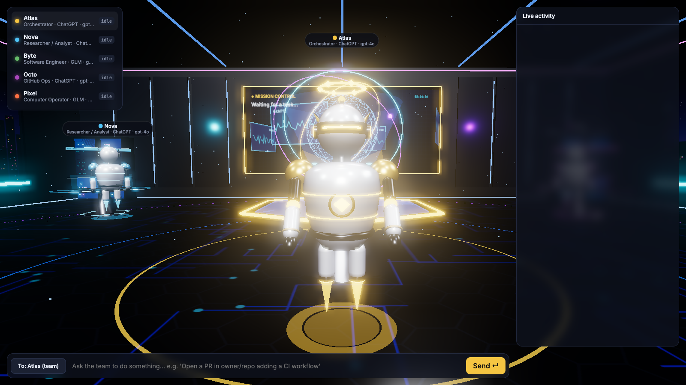 | 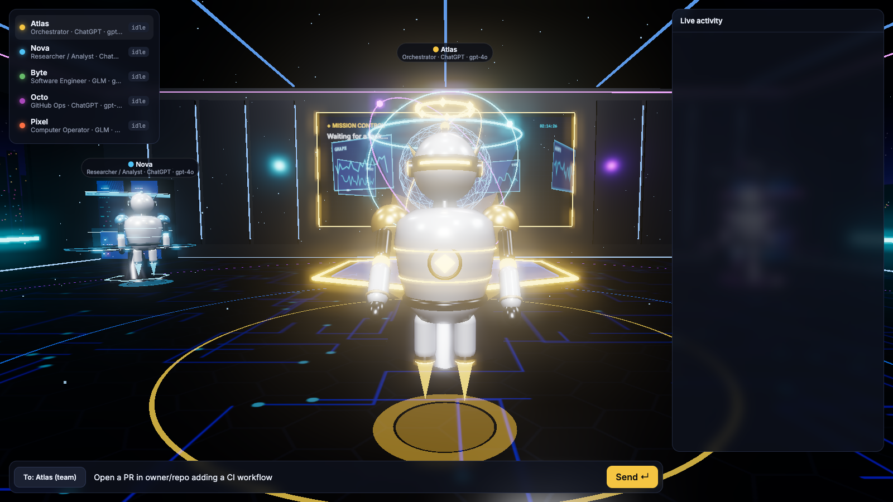 |
| **Atlas** (Orchestrator) | Typing a task to the team |

### Simulated task walkthrough

_These show a simulated task (example repo `acme/web`) with keys configured._

| | |
|---|---|
| 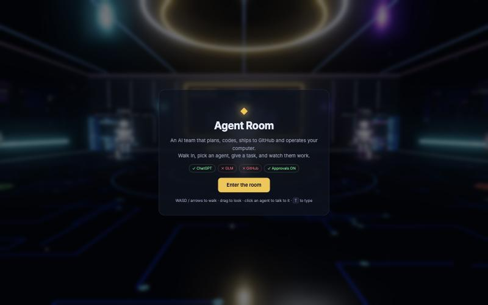 | 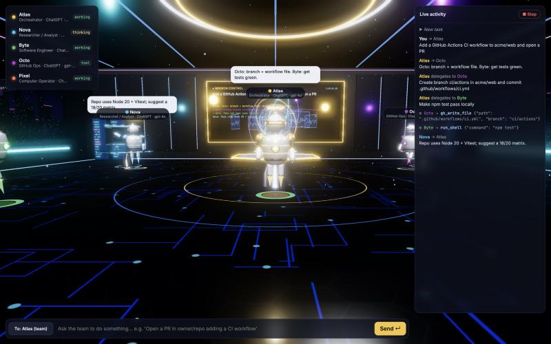 |
| 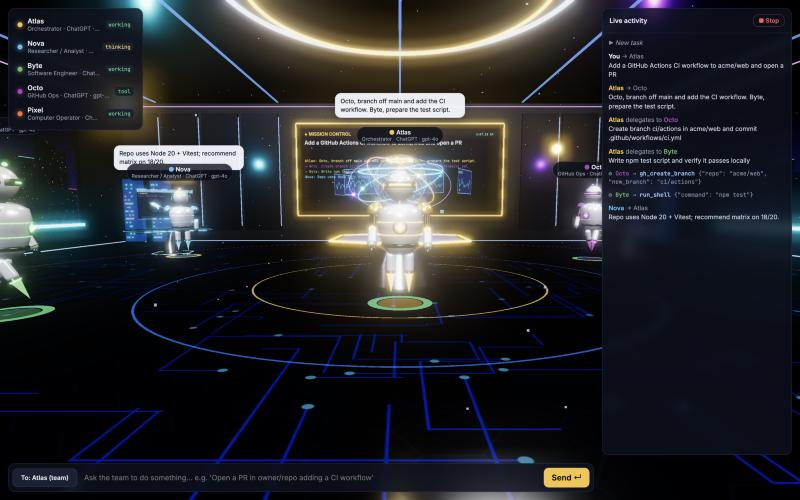 | 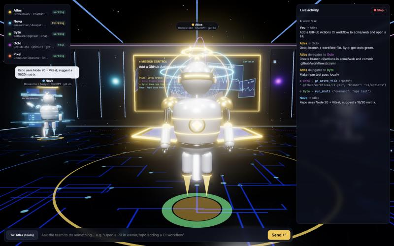 |
| 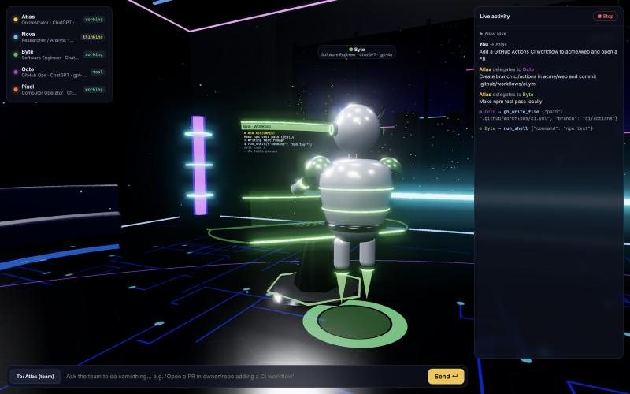 | 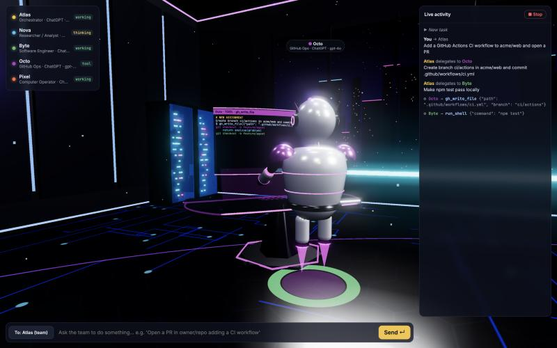 |
| 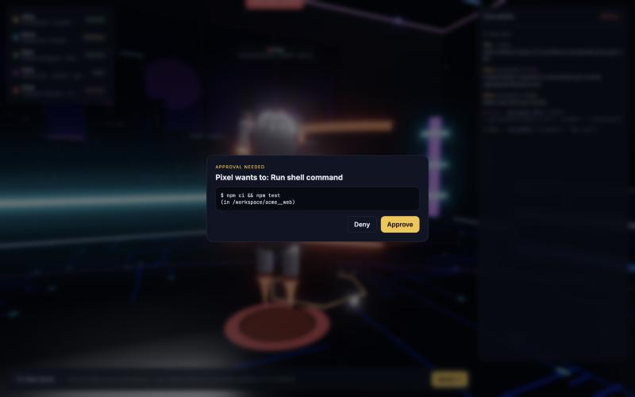 | 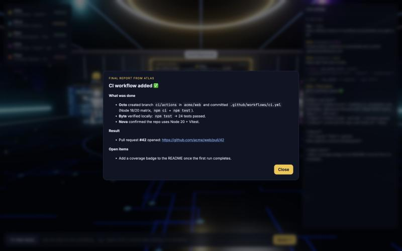 |

## The team

| Agent | Role | Default model | Tools |
|---|---|---|---|
| **Atlas** | Orchestrator – plans, delegates, reviews, writes final report | ChatGPT | routes work between teammates |
| **Nova** | Researcher / Analyst | ChatGPT | read files, list dirs |
| **Byte** | Software Engineer | GLM | shell, read/write files |
| **Octo** | GitHub Ops | ChatGPT | list repos, read files, clone, branch, commit, open PRs, issues, comments |
| **Pixel** | Computer Operator | GLM | shell, files, open apps, open URLs, screenshots |

Change who uses which model in `.env` (`CODER_PROVIDER=openai`, etc.). If only one key is set,
every agent uses that one.

## Run it

Requires Python 3.10+ (the script uses `uv` with Python 3.12 when available).

```bash
cp .env.example .env     # then fill in your keys
./run.sh                 # → http://localhost:8000
```

`.env` needs at least one of `OPENAI_API_KEY` / `GLM_API_KEY`, plus `GITHUB_TOKEN` for GitHub work.
GLM endpoint: `https://api.z.ai/api/paas/v4/` (international) or `https://open.bigmodel.cn/api/paas/v4/` (China).

Without keys the room still loads so you can explore it, but tasks won't run.

## In the room
- **WASD / arrows** walk · **Shift** run · **drag** to look · **scroll** to move forward/back
- **Click an agent** (or its row on the left) to talk to it directly; click the "To:" chip to go back to the whole team
- **T** or **Enter** to focus the task box
- **■ Stop** cancels the running task

## Safety
`REQUIRE_APPROVAL=true` (default): every shell command, app launch, URL open, screenshot, and file
read/write outside `./workspace` pops up an **Approve / Deny** dialog in the room. Agents work inside
`./workspace` (repos get cloned there). Octo is told never to push to the default branch – it makes a
branch and opens a PR. Only set `REQUIRE_APPROVAL=false` if you trust the task completely.

## How it works
```
backend/
  agents.py        LangGraph: orchestrator ⇄ workers loop, then a finish/report node
  tools/           github_tools.py (REST API + git clone), computer_tools.py (shell, files, apps)
  events.py        WebSocket event bus + approval requests
  llm.py           ChatOpenAI factory for OpenAI and GLM
  config.py        .env loading, per-agent provider selection, workspace path
  server.py        FastAPI: serves the room, /ws for live events
frontend/          Three.js room, robots, desks, mission board, HUD
```
Each worker is a LangChain `create_agent` (ReAct tool-calling agent). A callback handler streams
"thinking / tool / working" events to the browser, which drives the robot animations.
